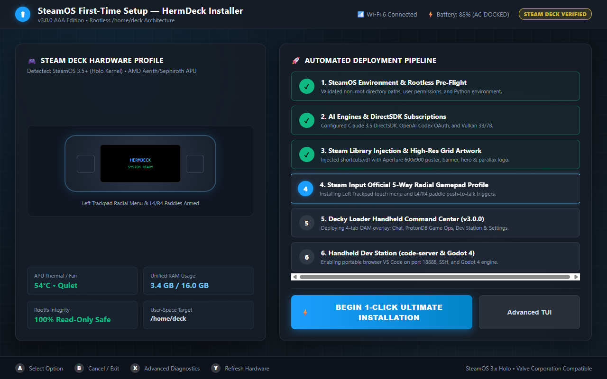
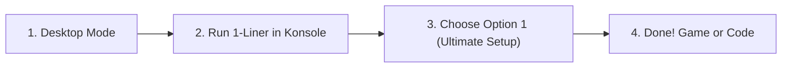
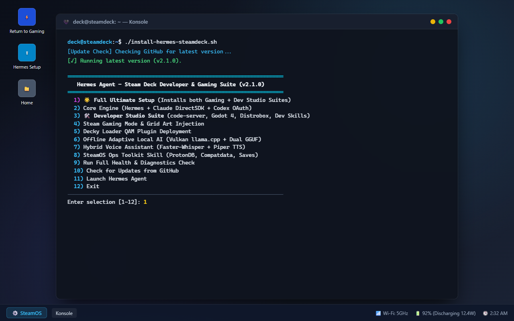
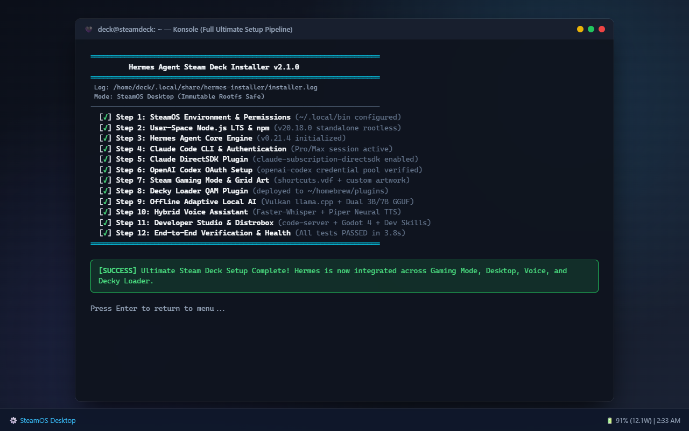
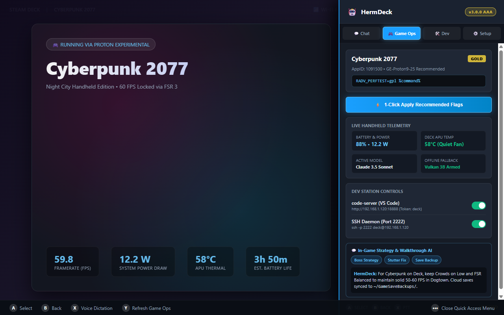
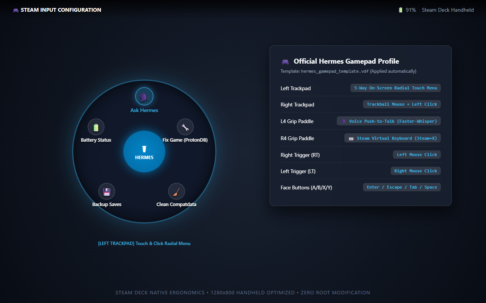
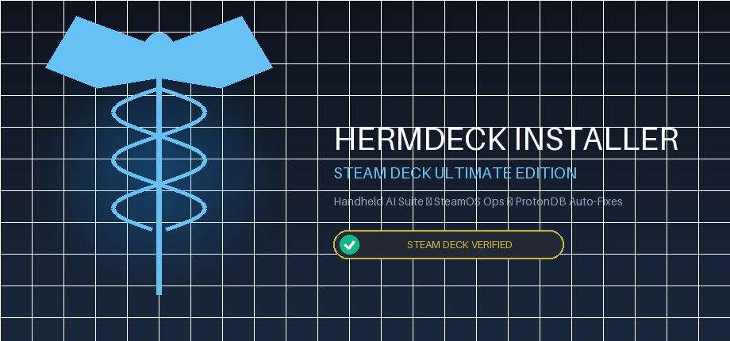
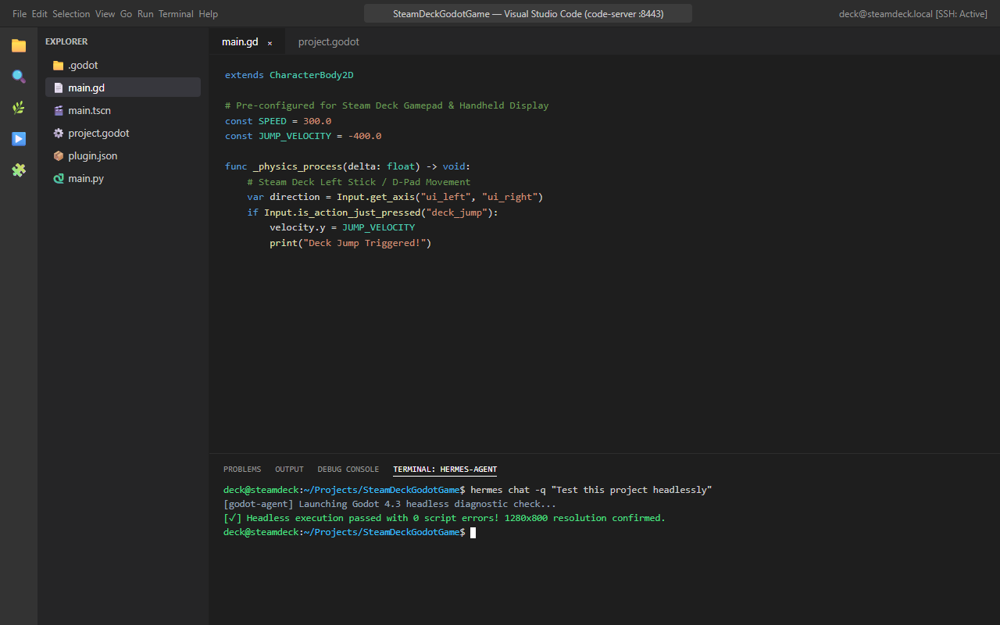
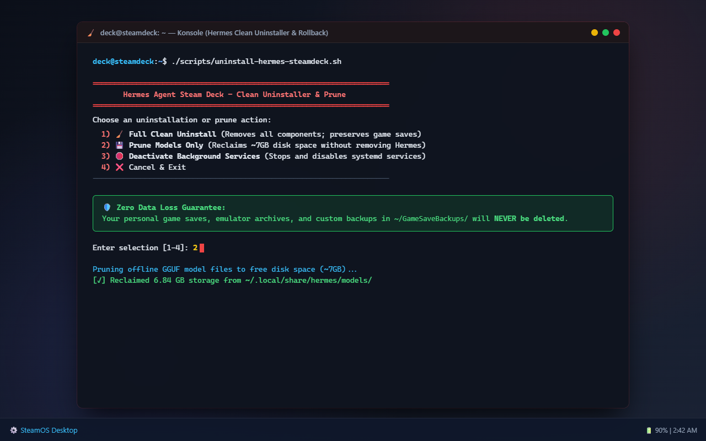

# ☤ HermDeck Installer — Steam Deck Ultimate Edition (v3.0.0 AAA)

<div align="center">

[](https://github.com/khaoticdev62/hermes-steamdeck-installer/releases/latest)
[](https://github.com/khaoticdev62/hermes-steamdeck-installer)
[](https://store.steampowered.com/steamos)
[](LICENSE)
[](README.md)
[](README.md)

**Turn your Steam Deck into an official Valve-grade autonomous handheld AI companion and portable development workstation with HermDeck Installer.**

[Quick Start](#-quick-start-30-seconds) • [Setup Wizard](#-steamos-first-time-setup-wizard) • [Gaming Mode & Decky](#-gaming-mode-companion--decky-command-center) • [Developer Studio](#-developer-studio-suite) • [Handheld Mapping](#-steam-input-handheld-mapping) • [Clean Uninstaller](#-clean-uninstaller--storage-pruning)

---

</div>

## 🚀 Quick Start (30 Seconds)

Switch your Steam Deck to **Desktop Mode** (*Steam Button > Power > Switch to Desktop*), open **Konsole**, and paste this single command:

```bash
curl -fsSL https://raw.githubusercontent.com/khaoticdev62/hermes-steamdeck-installer/main/install-hermdeck.sh | bash
```

> **Prefer a pre-packaged tarball?** Download [`hermdeck-steamdeck.tar.gz`](https://github.com/khaoticdev62/hermes-steamdeck-installer/releases/latest/download/hermdeck-steamdeck.tar.gz) (or `hermes-steamdeck.tar.gz`), extract it with `tar -xzf hermdeck-steamdeck.tar.gz`, and run `./install-hermdeck.sh`.

---

## 🖥️ SteamOS First-Time Setup Wizard (AAA Experience)

<div align="center">


*Official Valve-grade First-Time Setup Wizard running inside SteamOS, featuring live Steam Deck APU hardware diagnostics, rootless user-space validation, interactive pipeline stepper, and Web Audio SFX synthesis.*

</div>

Experience a native setup process matching official SteamOS system menus:
- 🎮 **Hardware & APU Profile:** Real-time display of APU thermal status, fan curve, RAM headroom, and `/home/deck` storage health.
- ⚡ **1-Click Automated Pipeline:** Deploys Claude DirectSDK, Codex OAuth, Vulkan offline models, Steam Input controller profiles, and Decky plugins with zero manual configuration.
- 🔊 **Steam Audio UI Cues:** Synthesizes authentic Valve navigation clicks, focus tones, and major triad completion chimes via zero-dependency Web Audio oscillators.
- 💻 **Dual-Layer Architecture:** Launch via Desktop shortcut or browser, or drop down to the enhanced 24-bit TrueColor Steam Big Picture TUI in Konsole anytime.

---

## 💡 What It Does

SteamOS is an immutable, read-only operating system. Installing traditional dev tools or AI models often breaks after SteamOS updates. 

**HermDeck Installer** runs **100% in user-space (`/home/deck`)**:
* 🛡️ **Zero Root Modification:** Never touches `steamos-readonly` — completely immune to system wipes during SteamOS updates.
* 🎮 **Gaming Mode First-Class Citizen:** Injects directly into your Steam library with custom artwork and embeds into the Decky Quick Access Menu (`...` button).
* ⚡ **Adaptive In-Game AI:** Switches between a lightweight 3B model during games (to prevent RAM stutters) and a full 7B/cloud model when idle.
* 🎙️ **Hands-Free Voice:** Hold a back paddle to talk to HermDeck while playing; hear replies through your speakers with natural neural TTS.
* 🛠️ **Full Handheld Dev Studio:** Run browser-based VS Code, Godot 4, Distrobox Arch containers, and SSH into your Deck from your laptop.

---

## 📖 Step-by-Step Installation Guide



### Step 1: Switch to Desktop Mode
Press the physical **STEAM** button on your Deck, go to **Power**, and select **Switch to Desktop**.

### Step 2: Open Konsole
Click the Application Launcher (bottom-left corner), open **System > Konsole**, and run:
```bash
curl -fsSL https://raw.githubusercontent.com/khaoticdev62/hermes-steamdeck-installer/main/install-hermes-steamdeck.sh | bash
```

### Step 3: Choose What to Install
The interactive management hub will appear:

<div align="center">


*The interactive terminal management hub running inside SteamOS Konsole, presenting modular options for both gaming enhancements and developer tools.*

</div>

* **Option 1 ("🌟 Full Ultimate Setup"):** Recommended. Automatically installs and configures all gaming and developer modules with live progress tracking:

<div align="center">


*Live automated installation pipeline running through environment checks, rootless toolchain setup, Claude & Codex authentication, and end-to-end diagnostics.*

</div>

* **Or pick individual modules (Options 2–8)** to customize your setup.

### Step 4: Add Desktop Shortcut (Optional)
To launch the installer or management hub right from your desktop anytime:
```bash
mv Hermes-Setup.desktop ~/Desktop/
gio set ~/Desktop/Hermes-Setup.desktop metadata::trusted true
```

---

## 🎮 Gaming Mode Companion & Decky Command Center

<div align="center">


*HermDeck Command Center v3.0.0 (AAA Edition) running inside the Decky Loader Quick Access Menu (`...` button) over Cyberpunk 2077, displaying Motiva Sans typography, Web Audio SFX synthesis, active game auto-detection, ProtonDB Gold rating, 1-click launch flags, and Steam Deck glyph navigation footers.*

</div>

The **HermDeck Decky Loader Plugin v3.0.0** transforms your Quick Access Menu (`...` button) into an official Valve-grade in-game command center:

| Tab | Features & Capabilities | Handheld Action |
| :--- | :--- | :--- |
| **💬 Assistant** | Live streaming chat, Push-to-Talk mic button, contextual suggestion chips (*"Boss Strategy"*, *"Boost FPS"*, *"Check Battery"*), background SteamOS Toast alerts, and Web Audio SFX chimes. | Type or dictate queries while staying in your game with audio confirmation. |
| **🎮 Game Ops** | Auto-detects running Steam game AppID & title via `/proc` and Steam client telemetry, queries live **ProtonDB ratings** (*Platinum, Gold, Silver, Bronze, Borked*), applies recommended launch flags in 1 click, and powers an in-game walkthrough assistant. | Tap **⚡ 1-Click Apply Recommended Flags** to optimize proton compatibility instantly. |
| **🛠️ Dev Station** | 1-click handheld toggles for **code-server (VS Code)** (displaying LAN URL and access token) and **SSH Daemon** (Port 2222), alongside a live APU thermal (°C), wattage draw, and RAM telemetry strip. | Tap toggle to turn your Deck into a remote development station. |
| **⚙️ Setup** | Universal model switcher: switch between **Claude 3.5 Sonnet/Haiku** (DirectSDK), **OpenAI Codex** (OAuth), and **Local Vulkan 3B/7B** (Offline), with **Steam Audio UI chimes**, **Piper Neural TTS** speech toggles, and auto-offline fallback. | Switch AI engines and audio preferences on the fly without restarting games. |

---

### 🎮 Steam Input Handheld Mapping

<div align="center">


*Official Steam Input controller profile for HermDeck: Left Trackpad 5-Way Radial Touch Menu, Right Trackpad trackball mouse, and L4/R4 grip paddles.*

</div>

When launching HermDeck in Steam Gaming Mode, the official Steam Input profile maps the Deck's controls:

| Control | Action in HermDeck Handheld Mode |
| :--- | :--- |
| **Left Trackpad (Radial Menu)** | 5-Way On-Screen Touch Menu: *Ask HermDeck*, *Fix Game (ProtonDB)*, *Clean Compatdata*, *Backup Saves*, *Battery Status* |
| **Right Trackpad** | High-precision Trackball Mouse + Click to Select |
| **L4 Grip Paddle** | Push-to-Talk Voice Dictation (`hermes-voice-listener`) |
| **R4 Grip Paddle** | Toggle Steam On-Screen Virtual Keyboard |
| **Triggers (RT / LT)** | Right Trigger = Left Click, Left Trigger = Right Click |
| **Face Buttons (A / B / X / Y)** | A = Enter, B = Escape, X = Tab, Y = Space |

---

### 🎨 Official Steam Library Artwork (Aperture Industrial Aesthetic)

The installer automatically injects high-resolution retina artwork into Steam's grid system, styled to match Valve first-party titles:

<div align="center">

| Vertical Capsule (600×900) | Wide Grid Banner (920×430) |
| :---: | :---: |
|  |  |
| *Retina capsule with gold **Steam Deck Verified** badge* | *Wide banner with illuminated telemetry & APU branding* |

</div>

- **Hero Background (`assets/hero.png`):** 1920×620 ultra-wide atmospheric background with soft volumetric cyan lighting.
- **Transparent Parallax Logo (`assets/logo.png`):** 1280×720 transparent PNG designed for Steam's parallax floating logo effect.

---

## 🛠️ Developer Studio Suite

Transform your Steam Deck into a self-contained portable development studio:

<div align="center">


*Browser-based VS Code (`code-server`) running directly on the Steam Deck, editing a Godot 4 project while running autonomous headless tests via Hermes Agent.*

</div>

### 1. Dual-Mode VS Code IDE
* **Browser-Based `code-server`:** Runs on port `8443` as an automated background service. Open `http://localhost:8443` on your Deck or `http://steamdeck.local:8443` on your laptop/iPad.
* **Remote SSH Pairing:** Run `hermes-ssh-toggle` to start `sshd` and connect from your PC with `ssh deck@steamdeck.local`.

### 2. Distrobox & Podman Arch Container
* Run `hermes-dev-shell` to enter a persistent Arch Linux container with full `pacman` access.
* Install any compiler, header, or library (`pacman -S gcc clang rustup go cmake make`) without modifying SteamOS.

### 3. Godot 4 Handheld Game Studio
* Standalone Godot 4.3 64-bit engine installed in `~/.local/bin/godot4`.
* Equipped with the **`godot-agent`** Hermes skill:
  - Scaffolds 2D/3D games pre-configured for the Deck (1280x800 resolution, twin sticks, paddles, gyro).
  - Generates typed GDScript 2.0.
  - Executes headless test runs to catch script errors automatically.

### 4. Decky Loader Plugin Builder
* Equipped with the **`decky-builder`** skill:
  - Scaffolds complete React/TypeScript + Python Decky plugins.
  - Deploys directly into `~/homebrew/plugins/` and reloads the service.
  - Live-streams `/home/deck/homebrew/logs/decky.log` into Hermes to debug runtime issues.

### 5. Rootless Podman & Docker Stacks
* Equipped with the **`container-ops`** skill:
  - Build Dockerfiles rootlessly.
  - Launch multi-container microservice stacks with `podman compose`.

---

## ⌨️ Handy Commands Cheat Sheet

| Command | Action |
| :--- | :--- |
| `hermes` | Launch interactive Hermes chat session in terminal |
| `hermes chat -q "your question"` | Quick one-shot query to Hermes |
| `hermes-dev-shell` | Open Arch Linux development container with `pacman` compilers |
| `hermes-ssh-toggle` | Start / stop SSH server for remote laptop connection (`steamdeck.local`) |
| `hermes-voice-listener` | Launch push-to-talk voice assistant |
| `godot4` | Launch Godot 4 Game Engine |
| `hermes model` | Interactive model provider picker |

---

## 🧹 Clean Uninstallation & Storage Prune

<div align="center">


*Interactive modular uninstaller and storage pruner with zero data loss guarantee for personal game saves.*

</div>

To cleanly remove components or free up storage without touching personal game saves:

```bash
./scripts/uninstall-hermes-steamdeck.sh
```

Choose from:
1. **🧹 Full Clean Uninstall:** Stops and cleans systemd user services, wipes Steam shortcuts and grid art, removes the Decky plugin, removes the Distrobox container, and removes all Hermes binaries. **Preserves your `~/GameSaveBackups/` archives intact.**
2. **💾 Prune Models Only:** Purges the `~/.local/share/hermes/models/` folder to reclaim **~7 GB of disk space** while keeping Hermes and developer tools operational.
3. **🛑 Deactivate Background Services:** Stops and masks all background daemons.

---

## ❓ Frequently Asked Questions

<details>
<summary><b>Will this survive SteamOS system updates?</b></summary>
<br>
<b>Yes, 100%.</b> Everything is installed inside <code>/home/deck/</code> (in <code>~/.local/bin</code>, <code>~/.hermes</code>, and <code>~/.npm-global</code>). SteamOS never wipes user home directories during OS updates.
</details>

<details>
<summary><b>Do I need to run 'steamos-readonly disable' or use sudo?</b></summary>
<br>
<b>No.</b> The entire installer and all developer toolchains (Node, Python, llama.cpp, Godot, Distrobox) run completely rootless without disabling the read-only rootfs.
</details>

<details>
<summary><b>How does the offline AI work when traveling without Wi-Fi?</b></summary>
<br>
When offline, Hermes automatically connects to the local Vulkan-accelerated <code>llama-server</code> running on your Deck's AMD APU. While playing a game, it uses a lightweight 3B model; when on Desktop, it scales to a 7B model. When Wi-Fi is restored, it seamlessly routes back to Claude 3.5/3.7 Sonnet or OpenAI Codex.
</details>

<details>
<summary><b>How do I update the installer?</b></summary>
<br>
Launch the installer and select <b>Option 10 ("Check for Updates from GitHub")</b>, or simply re-run the <code>curl</code> one-liner.
</details>

---

## 📜 License & Credits

* Created & maintained by [khaoticdev62](https://github.com/khaoticdev62).
* Powered by [Hermes Agent](https://github.com/NousResearch/hermes-agent) by Nous Research.
* Licensed under the [MIT License](LICENSE).
