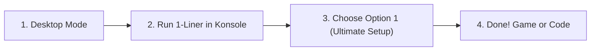

# ☤ Hermes Agent — Steam Deck Ultimate Edition

<div align="center">

[](https://github.com/khaoticdev62/hermes-steamdeck-installer/releases/latest)
[](https://store.steampowered.com/steamos)
[](LICENSE)
[](README.md)
[](README.md)

**Turn your Steam Deck into an autonomous handheld AI companion and portable software & game development powerhouse.**

[Quick Start](#-quick-start-30-seconds) • [What It Does](#-what-it-does) • [Step-by-Step Guide](#-step-by-step-installation-guide) • [Gaming Features](#-gaming-mode-companion) • [Developer Studio](#-developer-studio-suite) • [Cheat Sheet](#-handy-commands-cheat-sheet)

---

</div>

## 🚀 Quick Start (30 Seconds)

Switch your Steam Deck to **Desktop Mode** (*Steam Button > Power > Switch to Desktop*), open **Konsole**, and paste this single command:

```bash
curl -fsSL https://raw.githubusercontent.com/khaoticdev62/hermes-steamdeck-installer/main/install-hermes-steamdeck.sh | bash
```

> **Prefer a pre-packaged tarball?** Download [`hermes-steamdeck.tar.gz`](https://github.com/khaoticdev62/hermes-steamdeck-installer/releases/latest/download/hermes-steamdeck.tar.gz), extract it with `tar -xzf hermes-steamdeck.tar.gz`, and run `./install-hermes-steamdeck.sh`.

---

## 💡 What It Does

SteamOS is an immutable, read-only operating system. Installing traditional dev tools or AI models often breaks after SteamOS updates. 

**Hermes Steam Deck Ultimate Edition** runs **100% in user-space (`/home/deck`)**:
* 🛡️ **Zero Root Modification:** Never touches `steamos-readonly` — completely immune to system wipes during SteamOS updates.
* 🎮 **Gaming Mode First-Class Citizen:** Injects directly into your Steam library with custom artwork and embeds into the Decky Quick Access Menu (`...` button).
* ⚡ **Adaptive In-Game AI:** Switches between a lightweight 3B model during games (to prevent RAM stutters) and a full 7B/cloud model when idle.
* 🎙️ **Hands-Free Voice:** Hold a back paddle to talk to Hermes while playing; hear replies through your speakers with natural neural TTS.
* 🛠️ **Full Handheld Dev Studio:** Run browser-based VS Code, Godot 4, Distrobox Arch containers, and SSH into your Deck from your laptop.

---

## 📖 Step-by-Step Installation Guide



### Step 1: Switch to Desktop Mode
Press the physical **STEAM** button on your Deck, go to **Power**, and select **Switch to Desktop**.

### Step 2: Open Konsole
Click the Application Launcher (bottom-left corner), open **System > Konsole**, and run:
```bash
curl -fsSL https://raw.githubusercontent.com/khaoticdev62/hermes-steamdeck-installer/main/install-hermes-steamdeck.sh | bash
```

### Step 3: Choose What to Install
The interactive management hub will appear:

```text
====================================================================
   Hermes Agent - Steam Deck Developer & Gaming Suite (v2.1.0)
====================================================================
  1) 🌟 Full Ultimate Setup (Installs both Gaming + Dev Studio Suites)
  2) Core Engine (Hermes + Claude DirectSDK + Codex OAuth)
  3) 🛠️ Developer Studio Suite (code-server, Godot 4, Distrobox, Dev Skills)
  4) Steam Gaming Mode & Grid Art Injection
  5) Decky Loader QAM Plugin Deployment
  6) Offline Adaptive Local AI (Vulkan llama.cpp + Dual GGUF)
  7) Hybrid Voice Assistant (Faster-Whisper + Piper TTS)
  8) SteamOS Ops Toolkit Skill (ProtonDB, Compatdata, Saves)
  9) Run Full Health & Diagnostics Check
  10) Check for Updates from GitHub
  11) Launch Hermes Agent
  12) Exit
====================================================================
```

* **Option 1 ("🌟 Full Ultimate Setup"):** Recommended. Automatically installs and configures all gaming and developer modules.
* **Or pick individual modules (Options 2–8)** to customize your setup.

### Step 4: Add Desktop Shortcut (Optional)
To launch the installer or management hub right from your desktop anytime:
```bash
mv Hermes-Setup.desktop ~/Desktop/
gio set ~/Desktop/Hermes-Setup.desktop metadata::trusted true
```

---

## 🎮 Gaming Mode Companion

| Feature | Description | How to Use |
| :--- | :--- | :--- |
| **Steam Library Shortcut** | Injects Hermes into Steam with custom Grid, Banner, Hero, and Logo artwork. | Appears in your Steam Library under **Non-Steam Games**. |
| **Decky Loader QAM Plugin** | Overlays Hermes in the Quick Access Menu (`...` button) over running games. | Press `...` button during any game > select **Hermes Assistant**. |
| **Adaptive Dual-Tier AI** | Automatically monitors `gamescope`: drops to **Qwen 2.5 3B** (~2GB RAM) while gaming; scales to **Qwen 2.5 7B** when idle. | Fully automated background systemd user service. |
| **Paddle Push-to-Talk** | Hold back paddle (L4/R4) to dictate speech; transcribes via **Faster-Whisper** and speaks back via **Piper Neural TTS**. | Run `hermes-voice-listener` or bind to paddle via Steam Input. |
| **SteamOS Ops Toolkit** | Autonomous skills for ProtonDB fixes, cleaning orphaned prefixes, and save backups. | Ask Hermes: *"Fix Cyberpunk with ProtonDB"*, *"Clean unused compatdata"*. |

---

## 🛠️ Developer Studio Suite

Transform your Steam Deck into a self-contained portable development studio:

### 1. Dual-Mode VS Code IDE
* **Browser-Based `code-server`:** Runs on port `8443` as an automated background service. Open `http://localhost:8443` on your Deck or `http://steamdeck.local:8443` on your laptop/iPad.
* **Remote SSH Pairing:** Run `hermes-ssh-toggle` to start `sshd` and connect from your PC with `ssh deck@steamdeck.local`.

### 2. Distrobox & Podman Arch Container
* Run `hermes-dev-shell` to enter a persistent Arch Linux container with full `pacman` access.
* Install any compiler, header, or library (`pacman -S gcc clang rustup go cmake make`) without modifying SteamOS.

### 3. Godot 4 Handheld Game Studio
* Standalone Godot 4.3 64-bit engine installed in `~/.local/bin/godot4`.
* Equipped with the **`godot-agent`** Hermes skill:
  - Scaffolds 2D/3D games pre-configured for the Deck (1280x800 resolution, twin sticks, paddles, gyro).
  - Generates typed GDScript 2.0.
  - Executes headless test runs to catch script errors automatically.

### 4. Decky Loader Plugin Builder
* Equipped with the **`decky-builder`** skill:
  - Scaffolds complete React/TypeScript + Python Decky plugins.
  - Deploys directly into `~/homebrew/plugins/` and reloads the service.
  - Live-streams `/home/deck/homebrew/logs/decky.log` into Hermes to debug runtime issues.

### 5. Rootless Podman & Docker Stacks
* Equipped with the **`container-ops`** skill:
  - Build Dockerfiles rootlessly.
  - Launch multi-container microservice stacks with `podman compose`.

---

## ⌨️ Handy Commands Cheat Sheet

| Command | Action |
| :--- | :--- |
| `hermes` | Launch interactive Hermes chat session in terminal |
| `hermes chat -q "your question"` | Quick one-shot query to Hermes |
| `hermes-dev-shell` | Open Arch Linux development container with `pacman` compilers |
| `hermes-ssh-toggle` | Start / stop SSH server for remote laptop connection (`steamdeck.local`) |
| `hermes-voice-listener` | Launch push-to-talk voice assistant |
| `godot4` | Launch Godot 4 Game Engine |
| `hermes model` | Interactive model provider picker |

---

## ❓ Frequently Asked Questions

<details>
<summary><b>Will this survive SteamOS system updates?</b></summary>
<br>
<b>Yes, 100%.</b> Everything is installed inside <code>/home/deck/</code> (in <code>~/.local/bin</code>, <code>~/.hermes</code>, and <code>~/.npm-global</code>). SteamOS never wipes user home directories during OS updates.
</details>

<details>
<summary><b>Do I need to run 'steamos-readonly disable' or use sudo?</b></summary>
<br>
<b>No.</b> The entire installer and all developer toolchains (Node, Python, llama.cpp, Godot, Distrobox) run completely rootless without disabling the read-only rootfs.
</details>

<details>
<summary><b>How does the offline AI work when traveling without Wi-Fi?</b></summary>
<br>
When offline, Hermes automatically connects to the local Vulkan-accelerated <code>llama-server</code> running on your Deck's AMD APU. While playing a game, it uses a lightweight 3B model; when on Desktop, it scales to a 7B model. When Wi-Fi is restored, it seamlessly routes back to Claude 3.5/3.7 Sonnet or OpenAI Codex.
</details>

<details>
<summary><b>How do I update the installer?</b></summary>
<br>
Launch the installer and select <b>Option 10 ("Check for Updates from GitHub")</b>, or simply re-run the <code>curl</code> one-liner.
</details>

---

## 📜 License & Credits

* Created & maintained by [khaoticdev62](https://github.com/khaoticdev62).
* Powered by [Hermes Agent](https://github.com/NousResearch/hermes-agent) by Nous Research.
* Licensed under the [MIT License](LICENSE).
